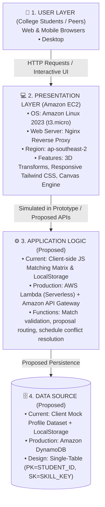

# 🤝 SkillBridge — Peer-to-Peer Skill Exchange
> **Blueprint to Live • Round 3: Final Build-Off**  
> *Information Science & Engineering (ISE) • AWS Student Builder Group DBIT*  
> *Region: ap-southeast-2 | Deployed on Amazon EC2 (Amazon Linux 2023 • Nginx)*

---

## 📌 1. Problem Statement
**Category:** Education  
**Challenge:** College students frequently struggle with skill gaps outside their specific core electives (e.g., an AWS cloud student wanting UI/UX design, or a Python data science student wanting Docker/DevOps). Commercial bootcamps and tutoring platforms are expensive and impersonal. 

**Solution:** **SkillBridge** is a zero-money, student-to-student skill barter platform where students list technical competencies they can teach and topics they want to master, discover reciprocal matches, and trade knowledge collaboratively.

---

## 🌟 2. Key Features & Interactive Capabilities
The prototype includes **3 full functional screens** and **interactive micro-interactions**:

### 🖥️ Screens & Views
1. **Screen 1 — Peer Discovery & Directory (`Explore Peers`):**
   * Real-time search by student name, bio, or skills.
   * Filter mode toggles: *All*, *Teaching (Skills Offered)*, and *Seeking (Skills Wanted)*.
   * Department filter (ISE, CSE, AIML, ECE) and quick-category topic pills.
   * **3D Double-Sided Card Flip (`rotateY(180deg)`):** Clicking a profile flips it in 3D to reveal student availability schedules, preferred meeting tools (Discord, Campus Library), and teaching styles.
   * **New Listing Creator:** Form allowing students to publish their own skill exchange profile.

2. **Screen 2 — Mutual Match Matrix (`Match Matrix`):**
   * Instant reciprocal matching algorithm: Select what you can teach and what you want to learn to identify **"Perfect Pairs"** who want your skill AND offer what you desire.

3. **Screen 3 — Simulated Interest Ledger (`Proposals Sent`):**
   * Full ledger tracking active proposals, hours pledged, meeting medium, and time stamps, persisted in the browser's `localStorage`.

### 🎨 Visual & UI Polish
* **Live Cursor-Reactive Interactive Background:** HTML5 Canvas particle network that smoothly reacts and pushes away based on the user's mouse coordinates.
* **Gamified Skill Badges:** Distinct peer badges such as *Patience Master*, *Deep Diver*, *Quick Solver*, and *Hackathon Veteran*.
* **Client-Side Shortlist / Bookmarks Drawer:** Bookmark favorite peers with badge counters stored locally.
* **Proposal Builder Modal & Toast Notifications:** Step-by-step commitment form with instant visual confirmation.
* **Live Campus Barter Ticker:** Real-time simulated feed showing active trades happening across college departments.

---

## 🏗️ 3. High-Level Architecture Diagram
As outlined in the *Blueprint to Live Participant Guide*, our architecture separates the presentation layer, proposed application logic, and proposed data store:



### Architectural Decisions & Rationale:
* **Why EC2 with Nginx?** Gives complete control over web serving, SSL termination, and reverse-proxying. It allows running microservices or Node/Python backends alongside the static UI as the platform scales.
* **Scalability Path:** Static assets can be placed in an Amazon S3 bucket fronted by **Amazon CloudFront** to provide sub-millisecond edge latency and DDoS protection via AWS Shield.
* **Database Choice:** **Amazon DynamoDB** provides single-digit millisecond latency for fast tag-based queries and mutual pair lookups.

---

## 🚀 4. How to Run Locally

To test and preview the application locally:

```bash
# 1. Navigate to the project root
cd c:\Btech_Projects\Signature_Event

# 2. Start a local HTTP server
python -m http.server 8080 --directory ./dist

# 3. Open your browser at:
http://localhost:8080
```

---

## ☁️ 5. Deployment on Amazon EC2 (1-Click)
The automated deployment script [`deploy-ec2.ps1`](./deploy-ec2.ps1) packages `./dist`, creates the Security Group (ports 80 & 22), and spins up the instance in `ap-southeast-2`:

```powershell
.\deploy-ec2.ps1 -Profile "signature-event" -Region "ap-southeast-2" -DistPath ".\dist"
```

Once confirmed locally, running this script yields the public IPv4 address (`http://<public-ip>`) to submit in the event portal.

---

## ⏱️ 6. Demo & 3-Minute Pitch Script

* **0:00 - 0:30 (Problem & Solution):**
  > "Respected judges, college students have diverse skills but lack a free, structured way to exchange them. SkillBridge is our peer-to-peer campus barter platform where knowledge is the only currency."
* **0:30 - 1:30 (Live Demo & Key Interactions):**
  > "Here is our live platform. Notice our interactive particle canvas. A student searching for *AWS Cloud* or *React* can browse peer profiles. Clicking any card flips it in 3D to inspect the student's availability and teaching pace. With our *Match Matrix*, selecting what you teach and what you want instantly calculates reciprocal matches. Clicking *Express Interest* generates a formal proposal saved in our live ledger."
* **1:30 - 2:15 (Architecture):**
  > "Our system is deployed live on an Amazon Linux 2023 EC2 instance running Nginx in `ap-southeast-2`. The architecture is decoupled: presentation on EC2, logic designed for AWS Lambda, and persistence mapped for Amazon DynamoDB single-table design."
* **2:15 - 2:45 (Impact & Next Steps):**
  > "SkillBridge turns campus peer tutoring into an engaging, gamified ecosystem. Thank you, and we welcome your questions!"
